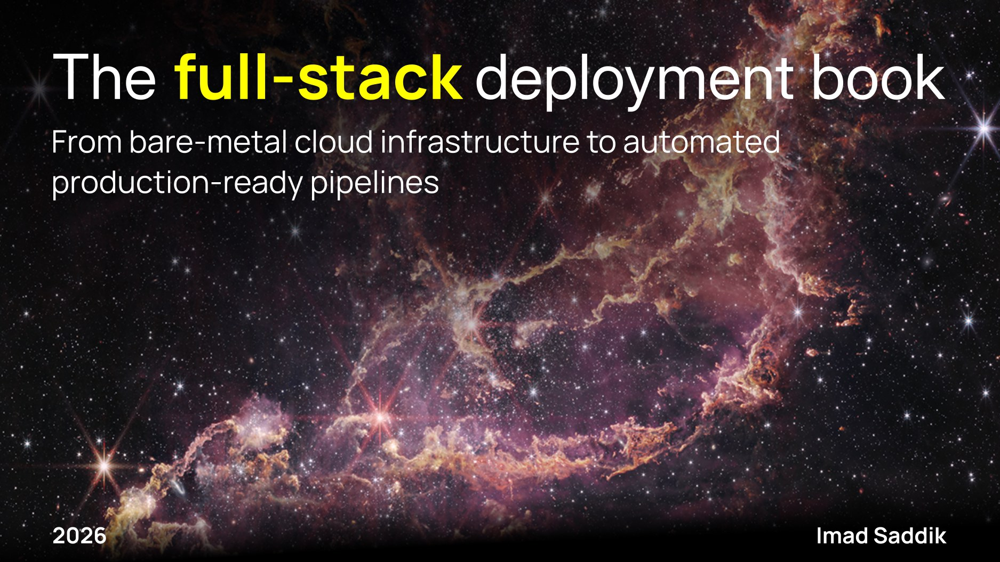

# Full stack deployment book



A practical guide to setting up, securing, and automating full-stack web applications on virtual machines or bare-metal servers.

I wrote this book after spending months running and refining a live production server. It walks you through building a complete web application stack, including a frontend, an API backend, databases, and search engines, on virtual machines or bare-metal servers.

## What you will learn

The book is divided into six modules, each focusing on a specific aspect of full-stack deployment:

- **[Module 1: The foundation](book/01_foundation.md)** - Provisioning cloud servers, rootless user management, and SSH hardening.
- **[Module 2: The application runtime](book/02_application-runtime.md)** - Manual stack deployment, memory swap optimization, Gunicorn process engineering, and Supervisor service management.
- **[Module 3: Data & search](book/03_data-and-search.md)** - Self-hosting and isolating database and indexing layers securely behind server firewalls.
- **[Module 4: Global delivery & security](book/04_global-delivery-security.md)** - Domain DNS configuration, edge proxy routing, end-to-end SSL/TLS certificates, and Nginx web-layer hardening.
- **[Module 5: The automation pipeline](book/05_automation-pipeline.md)** - Building a multi-stage GitHub Actions CI/CD framework with SCA, SAST, integration tests, and zero-downtime atomic deployments.
- **[Module 6: Optimization & maintenance](book/06_optimization-maintenance.md)** - Log-based traffic analytics with GoAccess, real-time resource observation, frontend DAST vulnerability scans, and automated maintenance tasks.

## Repository structure

- **[book/](book/)** - Markdown files containing the full text of the book modules.
- **[course-assets/](course-assets/)** - Presentation slides (ODF and generated PDF formats) accompanying the guide.
- **[scripts/](scripts/)** - Helper scripts.

## Development setup

### Prerequisites

`LibreOffice` is required for automatically generating `PDF` slides from `ODF` files. If you don't have it installed, you can find the instructions on the [official download page](https://www.libreoffice.org/download/download-libreoffice/).

Python 3.9+ with required dependencies. Install them using:

```bash
pip install -r requirements.txt
```

### Git hooks

This repository uses git hooks to automatically build PDF files whenever presentation slides are updated. To set up the hooks, run:

```bash
./scripts/install-hooks.sh
```

### Image optimization

To compress PNG images in the repository to optimized JPEGs, run:

```bash
python scripts/compress_images.py
```

Options you can pass to the script:

- `--dir`: Target image directory (defaults to `images/`).
- `--quality`: JPEG quality level (defaults to `88`).
- `--no-remove-pngs`: Preserve original PNG files after conversion.

## Contributing

Contributions are welcome! If you find a typo, have a suggestion, or want to improve a section, feel free to open an issue or submit a pull request.

## License

This project is licensed under the MIT License. See the [LICENSE](LICENSE) file for details.

## Contact

You can reach me through:

- **Email** - [simad3647@gmail.com](mailto:simad3647@gmail.com)
- **LinkedIn** - [Connect with me](https://www.linkedin.com/in/imadsaddik/)
